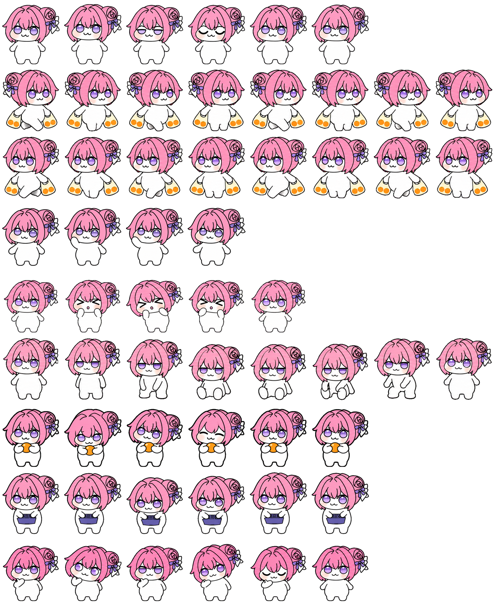

# Doro 人形版 · Codex Pet

一套用于 Codex Pet 的 Doro 人形版宠物资源。角色拥有粉色短发、圆润的白色身体，精灵图包含眨眼、走路、挥手、坐下、吃东西等动作。

## 文件

| 文件 | 说明 |
| --- | --- |
| `pet.json` | 宠物配置，ID 为 `doro-humanoid`，显示名称为「Doro 人形版」。 |
| `spritesheet.webp` | 宠物精灵图，来自原始文件「人形doro.webp」。 |

## 使用

下载仓库 ZIP 或克隆仓库，解压后将 `pet.json` 和 `spritesheet.webp` 保存在同一目录，用于自定义宠物配置。

`pet.json` 中的 `spritesheetPath` 为 `spritesheet.webp`，因此图片已按该名称保存；配置内容与图片内容保持原样。

## 预览

